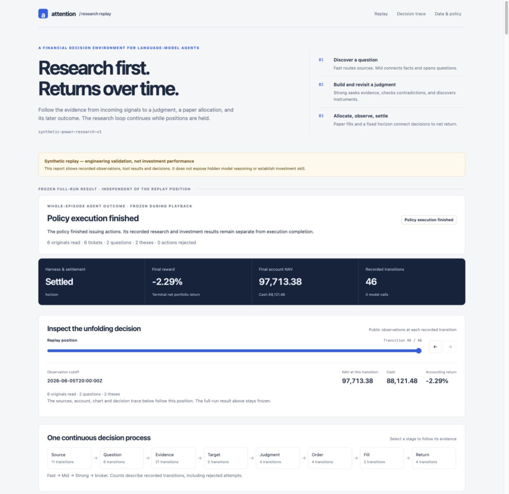
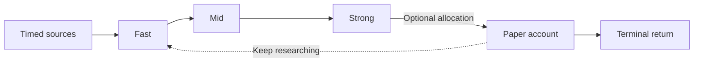

<h1 align="center">Attention Proxy</h1>

<p align="center"><strong>A financial research environment for language-model agents.</strong><br>
Follow a source from its arrival to a thesis, a paper position, and its eventual return.</p>

<p align="center">
  <a href="#quickstart">Run the demo</a> ·
  <a href="#research-loop">Research loop</a> ·
  <a href="#evaluation">Evaluation</a> ·
  <a href="./LOCAL_RUNTIME.md">Live pipeline</a>
</p>

<p align="center">
  <a href="https://github.com/ischencheng/Attention-Agent/actions/workflows/research-replay.yml"></a>
</p>

<p align="center">
  
</p>

<p align="center"><em>Replay viewer generated from a scripted episode with fictional sources and prices.</em></p>

## Quickstart

From a local checkout with Python 3.12+, run the demo in your Python environment:

```bash
python -m pip install -e .
demo_dir="$(mktemp -d)"
python -m environments.research_portfolio demo --output "$demo_dir"
printf 'Open %s/trace.html in your browser\n' "$demo_dir"
```

In `trace.html`, move the replay slider to see what information was available
at each step. In **Decision trace**, filter **Action** to `judge` and look at
**step 28**. A delivery delay weakens the original thesis, and the scripted
policy reduces the position at the next eligible market open. The demo runs
locally with fictional data and requires no model service or API keys.

## Research loop



| Stage | What the agent does |
| --- | --- |
| **Fast** | Triage incoming sources against a topic scope and route useful evidence. |
| **Mid** | Connect evidence across sources, accumulate facts, and surface open questions. |
| **Strong** | Read originals, look for contradictions, discover instruments when relevant, and revise judgments as evidence changes. |
| **Paper account** | Fill eligible orders at the next open and record positions, costs, and net asset value. |

The [environment contract](environments/research_portfolio/README.md) exposes
`reset()` and `step(action)` for scripted or model-selected actions. It gates
sources and prices by the current observation cutoff. An increase in exposure
requires a recorded judgment and its supporting research. Agents can keep
researching, revise a thesis, or wait while holding a position. The reward is
net portfolio return at a fixed horizon.

## Evaluation

| Evidence | What it shows |
| --- | --- |
| **[Synthetic demo](#quickstart)** | The scripted episode exercises evidence retrieval, thesis revision, paper fills, and settlement with a fixed action transcript. |
| **[Archived model run](environments/research_portfolio/EXPERIMENTS.md)** | The Qwen3-14B run reached one research theme and failed at its output limit before producing a judgment or position. Replay of the 74 recorded transitions reproduced the account state. |
| **[Live pipeline](LOCAL_RUNTIME.md)** | A separate runtime collects X and YouTube through Agent Reach backends, routes originals through Kafka and Flink, and stores research state in PostgreSQL. Its React dashboard uses FastAPI to expose the [source-to-decision trace](TRACE_DESIGN.md). |

The [evaluation card](environments/research_portfolio/EVALUATION.md) defines
source and price cutoffs, archive eligibility, and accounting checks. The
[machine-readable run result](environments/research_portfolio/results/2026-10-29-qwen14b-l40s-v1.json)
includes model identity, validity flags, and aggregate counts. The reconciler
checks account arithmetic. Assessing investment performance requires held-out
market episodes.

<details>
<summary>Inspect the files a run produces</summary>

| Files | What they contain |
| --- | --- |
| `episode.json`, `contract.json`, `framework.json` | Frozen scenario, horizon, costs, action budgets, and framework snapshot for new runs. |
| `trajectory.jsonl`, `actions.json` | Executed actions, tool results, rejections, and public observations. |
| `model-calls/`, `model-calls.json` | Model invocation identity, execution status, and usage when available. |
| `reconciliation.json`, `summary.json`, `trace.html` | Independent account check, run status and reward, and interactive replay. |

</details>

## Explore the repository

| Project area | Start here |
| --- | --- |
| **Research Portfolio** | [Environment and Codex runner](environments/research_portfolio/README.md) for archived research, paper execution, and replay. |
| **Attention Judgment** | [Research and forward observations](environments/attention_judgment/README.md) for continuing research and frozen decision packets. |
| **Financial Decision** | [Forecast environment](environments/financial_decision/README.md) for time-gated forecasts and a frozen scoring contract. |
| **Attention Provenance** | [Coding task](environments/attention_provenance/README.md) for fixing evidence links with a frozen baseline and an external PostgreSQL grader. |

For the full architecture and contributor workflow, see the [trace design](TRACE_DESIGN.md)
and [contributing guide](CONTRIBUTING.md).

## Tests

```bash
python -m pip install -e '.[archive]' confluent-kafka
python -m unittest discover -s scripts/tests -v
python -m unittest discover -s environments/research_portfolio/tests -v
```

These commands run the contract suites used in CI. CI also generates the
synthetic replay exhibit.
