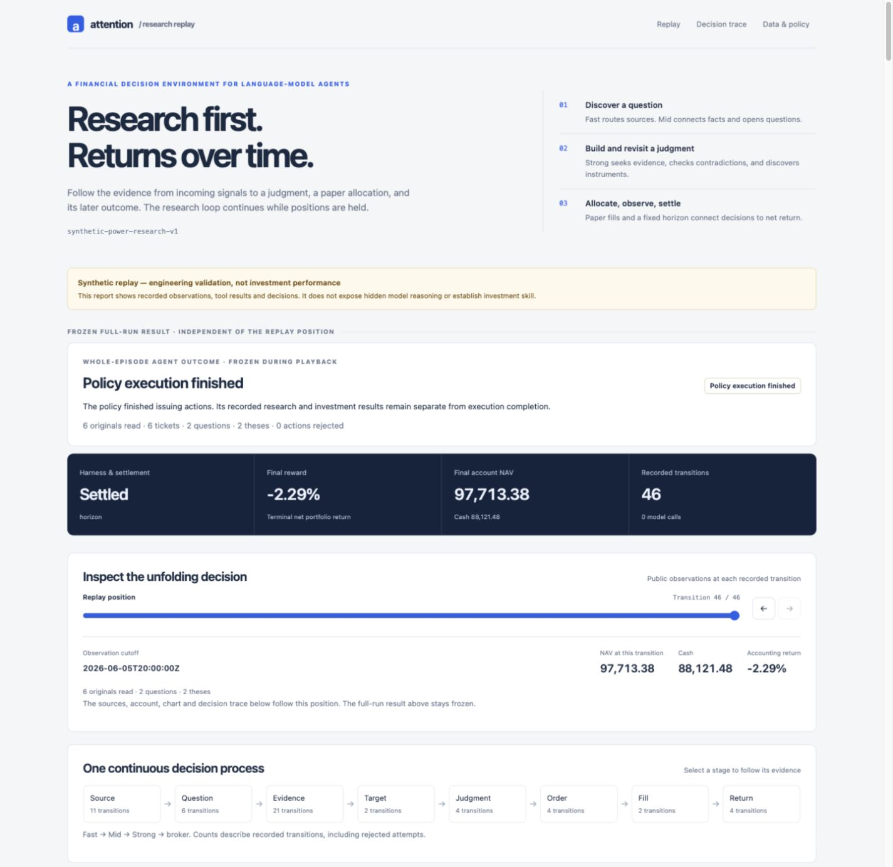
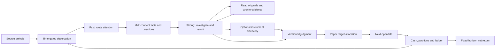

# Attention Proxy

**An inspectable financial research environment for long-horizon language-model agents.**

Follow a decision from incoming information through source triage, active research,
contradictory evidence, instrument discovery and paper position changes. Research
continues while positions are held. The episode's reward is net portfolio return
at a fixed horizon.

[Run an episode](#run-an-episode) ·
[Environment contract](environments/research_portfolio/README.md) ·
[Evaluation method](environments/research_portfolio/EVALUATION.md) ·
[Recorded experiments](environments/research_portfolio/EXPERIMENTS.md) ·
[Production runtime](LOCAL_RUNTIME.md)

The repository includes an offline `reset`/`step` environment, a bounded Codex
inference adapter, an interactive trajectory viewer, and the production
information pipeline that motivated its design. Model weight training and
held-out investment performance are separate experiments.

The first archived model attempts exposed an executable-path failure and then
96 rejected actions with no completed research or positions. The
[experiment record](environments/research_portfolio/EXPERIMENTS.md) keeps these
outcomes alongside the model, runtime and data limits.



*Synthetic demonstration: a fixed action transcript illustrates the viewer.
The full-run accounting result stays separate from the selected replay cutoff.*

## Run an episode

Use Python 3.12 or later. The synthetic example needs no model service, API keys
or production services:

```bash
python -m pip install -e .
python -m environments.research_portfolio demo --output /tmp/attention-rl-demo
```

Open `/tmp/attention-rl-demo/trace.html`. It shows a research question, an initial
paper allocation, new evidence, a thesis revision and reduced exposure, followed
by research into another topic. Move the replay position to inspect only the
sources and account state visible at that transition. The full-run outcome is
labelled separately.

This example uses fictional data and a fixed action transcript. Its return is
an accounting fixture. For model-selected actions and archived-source replay,
see the [environment guide](environments/research_portfolio/README.md).

## The decision process



The starting point is a topic scope. Instruments emerge during research; there
is no required holding or trade. A judgment can remain research-only. Waiting,
revising a thesis and reducing exposure are part of the same episode.

The environment exposes the cost, concentration and execution rules before the
policy acts. Increasing exposure requires a linked judgment and the recorded
research prerequisites. These checks establish the decision's evidence path;
the financial outcome still comes from the account ledger.

## What a run leaves behind

| Evidence | What to inspect |
| --- | --- |
| `episode.json`, `contract.json` | Frozen scenario, horizon, costs, action budgets and implementation hashes. |
| `trajectory.jsonl`, `actions.json` | Executed role actions, returned tool results, rejections and public observations. |
| `model-calls/`, `model-calls.json` | Actual invocation identity, execution status and usage when available. |
| `reconciliation.json` | Account arithmetic recomputed from recorded fills and the market tape. |
| `summary.json`, `trace.html` | Run eligibility, research path, positions, NAV and terminal reward. |

Archive admission additionally records source receipts, market-data vintage and
pinned policy identities. The viewer distinguishes verified fields, unknown
model knowledge cutoffs, historical price reconstruction and ineligible runs.
See the [evaluation card](environments/research_portfolio/EVALUATION.md) for the
complete evidence matrix and the boundaries of each check.

## Production and replay

The production application receives multiple information sources through
Kafka/Flink, runs Fast/Mid/Strong workers, persists state in PostgreSQL, and
exposes it through FastAPI and a React dashboard. The
[local runtime guide](LOCAL_RUNTIME.md) describes the actual services and
supervisor. The [trace design](TRACE_DESIGN.md) connects source records,
annotations, judgments and independently frozen versions.

The portfolio environment is an isolated implementation of the same research
process and role rules. It uses archived inputs, a deterministic event clock and
a simulated account. It does not run Kafka/Flink inside each episode or send
orders to a broker. Production operation, replay correctness and model quality
have separate evidence.

Two complementary environments retain their own contracts:

| Environment | Evaluation target |
| --- | --- |
| [Attention Judgment](environments/attention_judgment/README.md) | Continuing topic-led research and independently frozen production decision packets, with daily, weekly and monthly market observations. |
| [Financial Decision](environments/financial_decision/README.md) | Time-gated forecasts under a frozen prediction-scoring contract. |

Research-only state remains distinct from a formal prediction or an explicit
hold decision. The original product rationale is in [PRODUCT.md](PRODUCT.md).

## A reproducible software engineering task

The [Attention Provenance environment](environments/attention_provenance/README.md)
turns a concrete pipeline defect into a coding-agent task: preserve the evidence
behind an old decision after source corrections, duplicate deliveries and
annotation updates.

It provides a frozen unsolved checkout, an explicit task contract, an external
real-PostgreSQL grader, a reference repair and deliberately broken solutions.
The [verification record](environments/attention_provenance/VERIFICATION.md)
separates reference and mutation checks from model attempts. The current
checkout contains the repair; blind attempts start from the exported baseline.

## Validate the environment

```bash
python -m unittest discover -s environments/research_portfolio/tests -v
```

Tests cover temporal information boundaries, research gates, role scheduling,
order execution, costs, corporate actions, failure handling and trace rendering.
Adversarial cases change hidden future evidence and prices, attempt premature
reads, and corrupt recorded account results. The independent reconciler checks
account arithmetic; task difficulty, learned policy improvement and investment
skill require their own evaluation runs.
