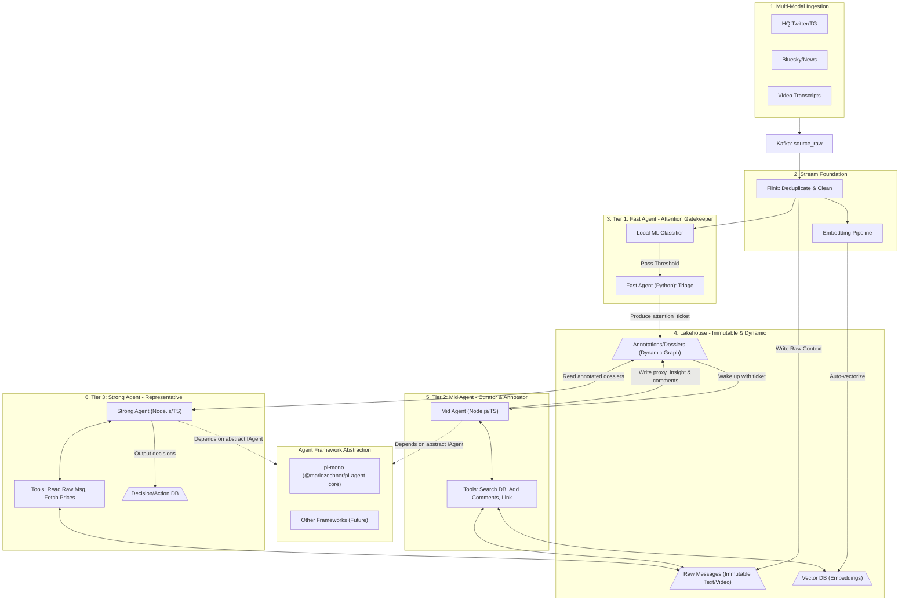

# AI Proxy Information Consumption Infrastructure

## Goal

将当前的事件研究管线彻底升级为**“AI 代理信息消费基础设施（Infra for AI Proxy Information Consumption）”**。
核心痛点是应对信息熵爆炸，解放人类注意力。我们要打造的是一条“代吃、代看、代想”的认知流水线。

核心原则：

1. **注意力守门（Attention Gatekeeping）**：Fast Agent 仅评估信息价值（Attention Score）并拦截噪音，**坚决不做过早的 Summary**，保留 100% 原始信息。
2. **整理与批注（Curation & Annotation）**：Mid Agent 不再强行把数据塞进特定的“事件阶段”中。它作为研究助理，拉取历史数据，进行交叉对比并在原始数据旁“写批注（Comments）”和建立关联。
3. **穿透式决策（Direct Raw Access）**：Strong Agent 代表具体的消费诉求（如特定投资策略）。它查看 Mid Agent 整理的案卷与批注，但在下决断前必须穿透到不可变的**原始数据**（原味推文、视频字幕）进行校验。
4. **Agent 框架解耦（Decoupled Agent Architecture）**：Mid Agent 和 Strong Agent 引入 [pi-mono](https://github.com/badlogic/pi-mono) (TS/JS 原生框架) 提供 Tool-calling 和大模型交互能力，但必须通过**适配器模式（Adapter Pattern）**包装，确保业务层只依赖 `IAgent` 抽象接口，未来可以随时拔插替换为其他框架。

## Target Architecture

## Storage & Data Objects

- `**raw_messages` (Immutable)**: 原汁原味保存。绝不被篡改或有损压缩。
- `**attention_ticket`**: Fast Agent 输出。仅包含元数据（ID、分数、分类标签），无 Summary。
- `**proxy_insight` / `annotations`**: Mid Agent 输出。它包含对一组 `raw_messages` 的关联边，以及 Mid Agent 的思考批注（如“这个观点与昨天 X 的发言存在分歧”）。
- `**decision_packet`**: Strong Agent 输出。基于目标策略的结论。

## Execution Phases

### Phase 1: Storage & Fast Agent Adjustment

- 调整 PostgreSQL schema 以支持纯净的 `raw_messages` 和带外键指针的 `annotations` 表。
- 将 Python 写的 Fast Agent 剥离“生成 Summary”的职责，只做轻量级评分和路由分发（发配 `attention_ticket`）。

### Phase 2: TS Monorepo & pi-mono Integration

- 在项目中引入一个独立的 TypeScript 服务目录（如 `ts-agents`）。
- 引入 `@mariozechner/pi-ai` 和 `@mariozechner/pi-agent-core`。
- **核心：编写 Adapter 层**。定义 `IAgentService` 和 `ITool` 接口，用 `pi-mono` 实现它，保障解耦。

### Phase 3: Mid Agent (Curator) Implementation

- 用 TypeScript 实现 Mid Agent 守护进程。
- 为其绑定工具：`searchVectorDb`, `searchRawMessages`, `writeAnnotation`, `linkMessages`。

### Phase 4: Strong Agent (Decision Maker) Implementation

- 用 TypeScript 实现 Strong Agent。
- 绑定业务特定的系统提示词和工具：`fetchAnnotations`, `**readRawMessageByUUID` (穿透工具)**。

