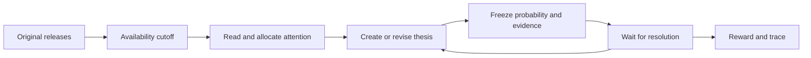

# Attention Financial Decision Environment

An RL environment for financial research over time. An agent reads incoming
originals, discovers a thesis, revises it when evidence changes, and can commit a
probability to a precisely defined future event. The environment controls which
information is available and returns a reward when that event can be resolved.

The research universe follows Attention Proxy's existing topics: AI,
semiconductors, datacenters, energy, earnings, capex, margins, valuation and macro.
Entities emerge from evidence. A thesis can concern an unlisted company or an
industry; a portfolio and a trade are not required.

## Run an episode

From the repository root with Python 3.12 or newer:

```bash
python -m pip install -e .
python -m environments.financial_decision demo --output /tmp/attention-rl-demo --seed 7
```

The demo is offline and uses fictional observations and a hand-written policy.
It needs no database, model account or API key. Use a new output directory for
each run. The output records the complete episode and separates research costs,
resolved forecast scores and unresolved questions:

- `trace.html`: readable evidence, thesis revisions, forecasts and reward timeline.
- `episode.json`: authoritative transitions, frozen reward contract and hashes.
- `trajectory.jsonl`: public reset and step records for a trainer.
- `checkpoint.json`: replay-validated state for resuming an episode.
- `summary.json`: coverage, costs, reward components and outcome status.

The public Python API accepts structured actions from any policy:

```python
from pathlib import Path
from environments.financial_decision import FinancialDecisionEnv

scenario = Path("environments/financial_decision/fixtures/demo.json")
env = FinancialDecisionEnv(scenario, max_steps=128)
observation, info = env.reset(seed=7)
observation, reward, terminated, truncated, info = env.step(
    {"type": "wait", "reason": "Await the next release."}
)
```

`reset` starts an isolated episode. `step` returns the next observation, scalar
reward, natural termination, budget truncation, and step diagnostics. A policy
must stop when either flag is true. The standard Gymnasium conventions are
specified in the [official API](https://gymnasium.farama.org/api/env/).

## External policies and replay

A trainer can call the Python API directly or keep the environment in its own
process. The JSONL protocol accepts one request and returns one response per line:

```bash
attention-financial-env stdio --scenario environments/financial_decision/fixtures/demo.json
```

```json
{"op":"reset","seed":7}
{"op":"step","action":{"type":"wait","reason":"Await new evidence."}}
{"op":"summary"}
```

Record a policy's actions as JSON objects, one per line, and replay them:

```bash
attention-financial-env replay \
  --scenario environments/financial_decision/fixtures/demo.json \
  --actions actions.jsonl --output /tmp/attention-rl-replay --seed 7
```

An incomplete transcript is reported as `unfinished`; extra actions after an
ended episode are rejected. Checkpoints replay the recorded actions against the
same manifest and reward contract, checking the resulting state and trace hashes:

```python
env.save_checkpoint("checkpoint.json")
restored = FinancialDecisionEnv(scenario, max_steps=128)
observation, info = restored.load_checkpoint("checkpoint.json")
```

Keep the manifest and outcome data on the environment side of the process
boundary. The protocol itself is local stdin/stdout, without an authentication or
network service layer.

## Agent interaction

| Action | Agent intent | Environment check |
| --- | --- | --- |
| `read` | Inspect an available original by `observation_id` | Publication and collection time must both be visible. |
| `judge` | Create or revise research using the existing judgment JSON schema | Cited originals were read; prior counterevidence remains; versions are retained. |
| `forecast` | Commit `probability` for a released `question_id`, linked to a thesis and evidence | The deadline has not passed; the question has no prior forecast; target and probability are frozen. |
| `wait` | Advance to the next scheduled information cutoff | Only evidence and resolutions available at the new cutoff become visible. |

A `judge` action contains `judgment` with `discoveries` and `no_action_reason`,
using [the existing structured judgment](../attention_judgment/schema.py).
Research stances include `research`, `watch`, `abstain`, `positive` and `negative`.
Its `forecasts` field stays empty: this environment uses a separate `forecast`
action to bind a probability to an operator-defined question. A forecast carries
`thesis_id`, `question_id`, `probability`, `evidence_ids` and `reason`.

The observation includes the current cutoff, released source metadata, originals
already read, thesis history, frozen forecasts, available outcomes and remaining
action budget. A policy receives neither future releases nor hidden resolution
labels. Arbitrary code running beside the environment can inspect process memory
or scenario files; this API is not a security sandbox. Run untrusted policies in a
separate process or service with access only to public observations and actions.



## Reward contract

For each resolved binary forecast, the environment emits this reward **once**:

```text
forecast_reward = 0.25 - (probability - outcome) ** 2
```

`outcome` is 0 or 1. This is improvement over the Brier error of a fixed 0.5
forecast, with range -0.75 to +0.25 per resolved question. Reading an original
for the first time costs 0.001; an invalid action costs 0.01 and consumes budget.
The reward contract and scenario identity are recorded with the trajectory.

Submitting a thesis, choosing a stance, abstaining and waiting earn no positive
reward. Repeating a forecast through another thesis does not earn another reward.
Future outcomes remain pending; unavailable outcomes remain unresolved and have
no predictive score. Coverage, forecasts submitted, resolutions and research costs
accompany total reward in the summary. `forecast_coverage_among_released` uses
questions released by the current cutoff as its denominator, including questions
whose deadlines have passed. A selective high score is not broad forecast skill.

Natural language reasoning quality is not reduced to a schema reward. The
validator checks source and memory constraints; it cannot establish whether an
economic explanation is true or whether two articles are independent evidence.
The operator owns the question, criterion and resolution provenance. A wrong
operator label is still a wrong reward.

## Optional Gymnasium adapter

```bash
python -m pip install -e '.[gym]'
```

```python
import json
import gymnasium as gym
import environments.financial_decision.gym_env

env = gym.make(
    "AttentionFinancialDecision-v0",
    scenario="environments/financial_decision/fixtures/demo.json",
    max_steps=128,
)
text, info = env.reset(seed=7)
text, reward, terminated, truncated, info = env.step(
    json.dumps({"type": "wait", "reason": "Wait for new evidence."})
)
observation = json.loads(text)
```

This adapter uses JSON text spaces for language-agent policies. It does not turn
text into a tensor policy for a numerical PPO implementation. An LLM trainer
supplies the policy and optimizer, collects these transitions, and assigns delayed
rewards to its generated actions. Neither the adapter nor the demo updates model
weights.

## Data and production boundary

An episode manifest has `schema_version`, `episode_id`, `mode`, an increasing
`timeline`, original `observations`, and forecast `questions`. Modes are
`synthetic` and `historical_replay`. Originals retain source identity, publication
time, availability time and content hash. Questions expose their criterion,
release time, deadline and resolution time. Their private resolution contains
status, binary value, availability time, evidence IDs and a reason. See the
[demo manifest](fixtures/demo.json) for a complete example.

Use preserved arrival times when constructing historical episodes. Later data
corrections must keep their later availability time. Pretrained models may know
historical outcomes even when the environment hides future records. Split real
episodes by time and source event, keep test outcomes outside the policy's files,
and freeze the reward contract before comparing policies.

The running Kafka/Flink/Fast/Mid/Strong system remains the source collection and
research application. Its existing [production observer](../attention_judgment/README.md)
freezes actual decision packets and evaluates eligible daily, weekly and monthly
price forecasts. Offline RL episode results do not enter that production ledger.
The new environment's operator-supplied binary resolutions do not automatically
settle financial market data or long-term business claims. No actual orders are
sent.

The bundled episode demonstrates software behavior, not real market performance,
a diverse training corpus, or an improvement in learned investment skill.
