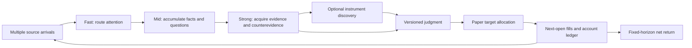

# Research-to-portfolio RL environment

An episode follows the original Attention Proxy process from incoming sources
through Fast/Mid/Strong research to paper positions. Its scalar reward is the
account's net return at a fixed horizon. Research continues while positions are
held, including questions unrelated to existing holdings.



## Run it

From the repository root, using Python 3.12 or later:

```bash
python -m pip install -e .
python -m environments.research_portfolio demo --output /tmp/research-demo
```

Open `/tmp/research-demo/trace.html`. The fictional case includes a backlog
research question, an initial position, a later delivery delay, a judgment
revision and reduction, then independent storage research while still holding.
Its fixed action transcript is a regression fixture, not an investment strategy.

For actual model-selected actions, use the existing Codex runner and a compatible
Codex 0.163 executable with an already configured login:

```bash
python -m environments.research_portfolio codex \
  --output /tmp/research-codex --max-calls 24 --timeout 120 \
  --codex-bin /path/to/codex
```

This invokes hosted models and can incur usage charges. Defaults match the
production role choices: `gpt-6-luna` for Fast/Mid and `gpt-6.1-sol` for Strong.
`--model` overrides all roles. The call limit and per-call timeout bound the run.
An incompatible executable or failed model call produces a failed-run artifact;
it is not counted as a successful cash-only strategy. Existing filled positions
are still settled at the original horizon so their outcome is retained.

The policy process receives only public observations. The environment executes
requested replay tools. Shell, web, app and other Codex tools are disabled; tool
events outside the replay interface are rejected. After a tool result, the model
must be invoked again before a dependent judgment or allocation can execute.
Same-role independent tool requests can be batched. Actions sampled for an old
cutoff are discarded when time advances, with executed/discarded indices saved.

Every output directory must be new or empty. Artifacts include:

- `episode.json` and `contract.json`: evaluator scenario, cost and horizon inputs,
  action budgets, and hashes of the scenario and implementation.
- `trajectory.jsonl`: durable actions, public observations, actual tool results,
  role/invocation IDs, rejection reasons, state changes and rewards.
- `actions.json`: executed actions for deterministic replay.
- `summary.json` and `trace.html`: research counts, account ledger, NAV and reward,
  with explicit synthetic/failed/ineligible labels.
- `model-calls/` and `model-calls.json`: actual CLI events, structured outputs,
  usage when reported, selected models and invocation status.
- `credit-contract.json`: role and observation boundaries for a later trainer.

Replay the executed actions with the same action budgets recorded in the contract:

```bash
python -m environments.research_portfolio replay \
  --scenario /tmp/research-demo/episode.json \
  --actions /tmp/research-demo/actions.json \
  --output /tmp/research-replay
```

## Environment and role contract

```python
from environments.research_portfolio import ResearchPortfolioEnv

env = ResearchPortfolioEnv("scenario.json", actions_per_cutoff=64, max_steps=512)
observation, info = env.reset(seed=7)
observation, reward, terminated, truncated, info = env.step(action)
```

`observation.action_contract` specifies the exact action fields. The engine has
no model, broker, database or network dependency. It exposes arrived source
metadata, fetched originals, routing tickets, accumulated themes, research
questions, all thesis versions, discovered instruments, tool results, current
account state and remaining action budgets. An instrument catalog describes
data coverage; only explicit discovery returns candidates to the policy.

| Role | Actions and responsibilities |
| --- | --- |
| Fast | Read originals if needed; `triage` each arrival with an original ID, reason and advance/ignore decision. |
| Mid | Read ticket originals; `accumulate` source-attributed facts and open questions in persistent themes. Three independent events from two providers, or an explicit authoritative-hard-data exception, make a theme eligible. |
| Strong | `open_research` from eligible themes; `read`, `search`, `discover`, `price_history` and `framework`; `judge`, `allocate`, `cancel`, `wait` or `stop`. A research judgment may have no instrument. |

Search runs over archived originals available at the current cutoff. It is a
lexical retrieval tool, with coverage stated in its result; an empty result does
not prove absence of contrary evidence. Both publication and actual receipt
times gate source availability. Price history contains completed raw bars only.
All instruments require the same complete session grid, including a terminal
close, before an episode can run. Historical data collection and provenance
verification are the dataset producer's responsibility.

The `framework` tool returns a bundled snapshot of the original
`skills/mrbrain_invest.py` framework and checklists, with its source hash. It is
reference material, not an asset assessment. Strong supplies six analysis
dimensions and evidence-backed PASS/FAIL/UNKNOWN prohibition checks. An increase
requires a latest investable judgment, passed checks, original reads, actual
contradiction search, instrument discovery, framework retrieval and observed
price history performed before that judgment. The engine checks these structural
and provenance requirements; it does not certify the truth of generated analysis.
Failed checks allow corrections, invalidation and risk reduction. Reductions
without passed increase gates have quantity caps at execution, so a price gap
cannot accidentally turn a lower target weight into additional shares.

Thesis revisions retain their question identity and previously recorded
counterevidence, explain what changed, and freeze ticket, tool and source links.
The trace presents observable decisions and evidence rather than hidden model
reasoning. Its filters and identifiers connect source arrivals through orders,
fills and terminal account value.

## Paper accounting and reward

The frozen reward contract is:

```text
NAV(t) = cash(t) + sum(quantity(asset,t) * raw_mark(asset,t)) + receivables(t)
reward(T) = NAV(T) / initial_cash - 1
```

Intermediate scalar rewards are zero. Realized and unrealized gains/losses both
affect terminal NAV. Fees debit cash once; slippage is in fill prices. The
environment does not add forecast, reading, writing or rationale bonuses.

The initial account is cash-only and long-only, with no borrowing. A complete
target-weight mapping sets omitted positions to zero and leaves residual weight
in cash. An unchanged allocation may trade; `wait` holds existing quantities.
Orders fill at the shared next market open strictly after submission. The
broker sizes from pre-trade opening NAV, sells first, then scales buys to cash
including fees. Fractional shares are permitted. Configured `max_weight` bounds
requested weights; prices and costs can change realized weights afterward.
Pending replacement/cancellation is explicit. There are no liquidity/volume
or market-impact models beyond the frozen slippage parameter in this version.

Splits change quantities against raw prices. Dividends establish entitlement at
the ex event, enter NAV as receivables, and become spendable cash at payment.
Ex-date buyers do not receive the prior entitlement. Only the declared split
and dividend action types are supported; unsupported actions and incomplete
price grids are rejected. This version has no bankruptcy/delisting simulator.

The horizon is fixed before the first policy action. Per-cutoff action limits
advance time even for invalid/repetitive actions. Total-step exhaustion or
`stop` cancels unfilled orders and settles existing holdings at the original
horizon. Terminal valuation marks positions; it does not invent a liquidation
fill or discard unrealized losses. Calling `step` after termination is rejected,
so the terminal reward is delivered once.

## Scope and evaluation

This is an isolated offline implementation of the production role contracts.
The live Kafka/Flink/PostgreSQL pipeline, scheduler and existing decision-packet
evaluation ledger remain independently operated. This environment does not
consume live decision packets or publish executable broker orders. The existing
`financial_decision` forecast environment and its frozen rewards remain available.

The bundled case is synthetic. Real return comparisons require archived
point-in-time sources, independently verified raw prices/corporate actions,
predeclared horizons and costs, and held-out time/event groups. Compare cash and
other preregistered policies under identical inputs. A positive period return
does not prove the preceding thesis was true.

The rollout starts at source intake and records Fast/Mid/Strong decisions with
invocation IDs. Feed and tool content are observations. Selected policy outputs
are candidate trainable segments; unexecuted batch actions are identified.
This inference adapter does not supply sampled token IDs/log probabilities or
implement a training algorithm. Connecting an RL trainer and demonstrating
held-out learning are separate work. If only Strong is trained, report a partial
policy experiment rather than end-to-end training.

The Python object is an API boundary, not an isolation sandbox for arbitrary
in-process policy code. Use the provided tool-disabled model harness or a
separate restricted policy worker when evaluator state must be inaccessible.

Run the contract tests with:

```bash
python -m unittest discover -s environments/research_portfolio/tests -v
```
