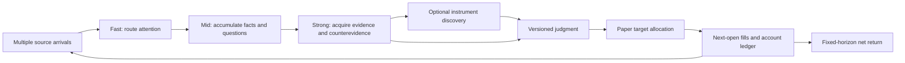

# Research-to-portfolio RL environment

An episode follows the original Attention Proxy process from incoming sources
through Fast/Mid/Strong research to paper positions. Its scalar reward is the
account's net return at a fixed horizon. Research continues while positions are
held, including questions unrelated to existing holdings.



## Run it

From the repository root, using Python 3.12 or later:

```bash
python -m pip install -e .
python -m environments.research_portfolio demo --output /tmp/research-demo
```

Open `/tmp/research-demo/trace.html`. The fictional case includes a backlog
research question, an initial position, a later delivery delay, a judgment
revision and reduction, then independent storage research while still holding.
Its fixed action transcript is a regression fixture, not an investment strategy.

For actual model-selected actions, use the existing Codex runner and a compatible
Codex 0.163 executable with an already configured login:

```bash
python -m environments.research_portfolio codex \
  --output /tmp/research-codex --max-calls 24 --timeout 120 \
  --codex-bin /path/to/codex
```

This invokes hosted models and can incur usage charges. Defaults match the
production role choices: `gpt-6-luna` for Fast/Mid and `gpt-6.1-sol` for Strong.
`--model` overrides all roles. The call limit and per-call timeout bound the run.
An incompatible executable or failed model call produces a failed-run artifact;
it is not counted as a successful cash-only strategy. Existing filled positions
are still settled at the original horizon so their outcome is retained.

The policy process receives only public observations. The environment executes
requested replay tools. Shell, web, app and other Codex tools are disabled; tool
events outside the replay interface are rejected. After a tool result, the model
must be invoked again before a dependent judgment or allocation can execute.
Same-role independent tool requests can be batched. Actions sampled for an old
cutoff are discarded when time advances, with executed/discarded indices saved.
Each call also receives the previous batch's executed actions and feedback,
including rejection reasons. A rejection ends the batch so the policy can
correct it before attempting dependent actions.

The inference observation retains durable facts, questions, judgments, source
metadata and tool receipts. Pending original bodies are delivered intact when
their requesting role next runs, including after idle cutoffs or intervening
calls to other roles. Delivered bodies are available through another explicit read. This memory projection removes
duplicate copies of past articles; it does not generate hidden summaries or
truncate newly retrieved evidence.

Malformed action JSON or a malformed action batch consumes one rejected step
and returns its decoder error to the next model call. The original output is
retained under `model-calls/`; the budget-consuming marker is explicitly
decoder-authored and excluded from trainable action segments. Call, step and
time limits still apply. Transport failures and external tool calls remain
failed runs. `policy_budget_exhausted` distinguishes a controller-enforced stop
from a policy decision to finish.

Every output directory must be new or empty. Artifacts include:

- `episode.json` and `contract.json`: evaluator scenario, cost and horizon inputs,
  action budgets, and hashes of the scenario and implementation.
- `framework.json`: the framework tool snapshot frozen when the environment is
  constructed, with its canonical hash in the contract for new runs.
- `trajectory.jsonl`: durable actions, public observations, actual tool results,
  role/invocation IDs, rejection reasons, state changes and rewards.
- `actions.json`: executed actions for deterministic replay.
- `summary.json` and `trace.html`: research counts, account ledger, NAV and reward,
  with explicit synthetic/failed/ineligible labels.
- `model-calls/` and `model-calls.json`: actual CLI events, structured outputs,
  usage when reported, selected models and invocation status.
- `credit-contract.json`: role and observation boundaries for a later trainer.

Replay the executed actions with the same action budgets recorded in the contract:

```bash
python -m environments.research_portfolio replay \
  --scenario /tmp/research-demo/episode.json \
  --actions /tmp/research-demo/actions.json \
  --framework-snapshot /tmp/research-demo/framework.json \
  --output /tmp/research-replay
```

Reuse the retained framework snapshot to prevent a later code or framework
update from changing replay tool content. Earlier artifacts may lack this file;
disclose that limitation when replaying them.

## Environment and role contract

```python
from environments.research_portfolio import ResearchPortfolioEnv

env = ResearchPortfolioEnv("scenario.json", actions_per_cutoff=64, max_steps=512)
observation, info = env.reset(seed=7)
observation, reward, terminated, truncated, info = env.step(action)
```

`observation.action_contract` specifies the exact action fields. The engine has
no model, broker, database or network dependency. It exposes arrived source
metadata, fetched originals, routing tickets, accumulated themes, research
questions, all thesis versions, discovered instruments, tool results, current
account state and remaining action budgets. An instrument catalog describes
data coverage; only explicit discovery returns candidates to the policy.
`observation.execution_contract` exposes the frozen concentration limit, costs,
cash constraints, order execution rules and terminal valuation convention, so
policies can plan valid allocations without guessing hidden constraints.

| Role | Actions and responsibilities |
| --- | --- |
| Fast | Read originals if needed; `triage` each arrival with an original ID, reason and advance/ignore decision. |
| Mid | Read ticket originals; `accumulate` source-attributed facts and open questions in persistent themes. Three independent events from two providers, or an explicit authoritative-hard-data exception, make a theme eligible. |
| Strong | `open_research` from eligible themes; `read`, `search`, `discover`, `price_history` and `framework`; `judge`, `allocate`, `cancel`, `wait` or `stop`. A research judgment may have no instrument. |

Search runs over archived originals available at the current cutoff. It is a
lexical retrieval tool, with coverage stated in its result; an empty result does
not prove absence of contrary evidence. Both publication and actual receipt
times gate source availability. Price history contains completed raw bars only.
All instruments require the same complete session grid, including a terminal
close, before an episode can run. Historical data collection and provenance
verification are the dataset producer's responsibility.

The `framework` tool returns a bundled snapshot of the original
`skills/mrbrain_invest.py` framework and checklists, with its source hash. It is
reference material, not an asset assessment. Strong supplies six analysis
dimensions and evidence-backed PASS/FAIL/UNKNOWN prohibition checks. An increase
requires a latest investable judgment, passed checks, original reads, actual
contradiction search, instrument discovery, framework retrieval and observed
price history performed before that judgment. The engine checks these structural
and provenance requirements; it does not certify the truth of generated analysis.
Failed checks allow corrections, invalidation and risk reduction. Reductions
without passed increase gates have quantity caps at execution, so a price gap
cannot accidentally turn a lower target weight into additional shares.

Thesis revisions retain their question identity and previously recorded
counterevidence, explain what changed, and freeze ticket, tool and source links.
The trace presents observable decisions and evidence rather than hidden model
reasoning. Its filters and identifiers connect source arrivals through orders,
fills and terminal account value.

## Paper accounting and reward

The frozen reward contract is:

```text
NAV(t) = cash(t) + sum(quantity(asset,t) * raw_mark(asset,t)) + receivables(t)
reward(T) = NAV(T) / initial_cash - 1
```

Intermediate scalar rewards are zero. Realized and unrealized gains/losses both
affect terminal NAV. Fees debit cash once; slippage is in fill prices. The
environment does not add forecast, reading, writing or rationale bonuses.

The initial account is cash-only and long-only, with no borrowing. A complete
target-weight mapping sets omitted positions to zero and leaves residual weight
in cash. An unchanged allocation may trade; `wait` holds existing quantities.
Orders fill at the shared next market open strictly after submission. The
broker sizes from pre-trade opening NAV, sells first, then scales buys to cash
including fees. Fractional shares are permitted. Configured `max_weight` bounds
requested weights; prices and costs can change realized weights afterward.
Pending replacement/cancellation is explicit. There are no liquidity/volume
or market-impact models beyond the frozen slippage parameter in this version.

Splits change quantities against raw prices. Dividends establish entitlement at
the ex event, enter NAV as receivables, and become spendable cash at payment.
Ex-date buyers do not receive the prior entitlement. Only the declared split
and dividend action types are supported; unsupported actions and incomplete
price grids are rejected. This version has no bankruptcy/delisting simulator.

The horizon is fixed before the first policy action. Per-cutoff action limits
advance time even for invalid/repetitive actions. Total-step exhaustion or
`stop` cancels unfilled orders and settles existing holdings at the original
horizon. Terminal valuation marks positions; it does not invent a liquidation
fill or discard unrealized losses. Calling `step` after termination is rejected,
so the terminal reward is delivered once.

## Captured-source replay

Collection runs before the policy. Freeze the episode interval, topic scope,
supported instrument catalog, costs and model identity before inspecting returns.
The current collector reads the existing production database in a read-only,
repeatable-read transaction; it does not change offsets or application state.
It retains original envelopes and raw payloads, including duplicate versions.
Availability is the actual database receipt, never a backdated publication time.

Install the archive extra before collecting prices, building or validating an
archive, or running the full test suite:

```bash
python -m pip install -e '.[archive]'
```

```bash
python -m environments.research_portfolio.collector export-db \
  --start 2026-10-22T00:00:00Z --end 2026-10-26T20:00:00Z \
  --output /tmp/sources.json
python -m environments.research_portfolio.collector prices \
  --assets /path/to/catalog.json \
  --start 2026-10-19 --end 2026-10-26 \
  --output /tmp/market.json
```

These optional collectors use the database and calendar dependencies in
`scripts/requirements-local.txt`. Export `DB_HOST`, `DB_PORT`, `DB_NAME`, `DB_USER`
and `DB_PASSWORD` into the collector process's environment. The collector reads
these variables directly; it does not load a `.env` file. Credentials do not
belong in an archive or Git.
The asset file is an array of records with `asset_id`, `symbol`, `name`,
`available_at` and `terms`, matching the scenario catalog. It declares supported
data coverage, not required holdings. Preserve the source of the catalog and
its selection rule. The current price adapter supports US daily raw opens and
closes from Yahoo Finance. Admission checks each session's open and close against
the XNYS calendar in `exchange-calendars==4.13.2`, including holidays and early
closes. This binds timestamps independently of provider prices; it does not
certify their historical vintage. Unsupported corporate
actions or dividends without an explicit payment date fail admission.

An episode specification is a JSON object with `episode_id`, `start_at`, `end_at`,
`scope` (topic strings), `portfolio` (`initial_cash`, `fee_bps`, `slippage_bps`,
`max_weight`), and `selection` (the predeclared selection method). Source coverage
must span the whole episode, including the holding period.

```bash
python -c 'import json; from environments.research_portfolio.modal_policy import policy_manifest; print(json.dumps(policy_manifest(), indent=2))' > /tmp/policy-manifest.json
python -m environments.research_portfolio.archive build \
  --spec /path/to/spec.json --sources /tmp/sources.json \
  --market /tmp/market.json --policies /tmp/policy-manifest.json \
  --output /tmp/admitted-archive
python -m environments.research_portfolio.archive validate /tmp/admitted-archive
```

Admission binds derived sources and prices to their preserved originals and
hashes. The served model must independently match the archived artifact hashes.
The GPU adapter pins `Qwen/Qwen3-14B` at revision
`40c069824f4251a91eefaf281ebe4c544efd3e18`, published before the October 2026
episode. Its exact training cutoff is unknown. Historical prices fetched later
remain explicitly labelled
`historical_reconstruction`, with `strict_point_in_time_eligible: false`.
Hashes establish consistency, not the truth of publisher claims or the absence
of later provider revisions. See [EVALUATION.md](EVALUATION.md).

### Run a pinned GPU policy

Use an authenticated Modal environment with SDK 1.5.5. Install the repository
package in that interpreter; it supplies the JSON-schema validation dependency:

```bash
python -m pip install -e '.[archive]' 'modal==1.5.5'
```

The [GPU policy adapter](modal_policy.py) builds a pinned model image before
allocating one NVIDIA L40S, then verifies the checkpoint files on the worker.
The worker runs BF16 inference through vLLM. It receives text observations and
an output schema; it has no archive files, public serving endpoint or outbound
network access. The loopback server below is a transport bridge; model weights
and inference stay on the remote GPU. Starting it allocates paid GPU resources.

```bash
python -m environments.research_portfolio.model_server \
  --backend modal --port 62192 --audit-dir /tmp/model-audit \
  --max-requests 110 --max-output-tokens 2048
```

In another terminal, use the repository's Python environment and a compatible
Codex 0.163 executable:

```bash
python -m environments.research_portfolio codex \
  --archive /tmp/admitted-archive \
  --model-endpoint http://127.0.0.1:62192/v1 \
  --codex-bin /path/to/codex \
  --output /tmp/archived-rollout \
  --max-calls 96 --timeout 240 --max-steps 4096
```

`--archive` freezes the model identity and enables both strict tools and virtual
scheduling. All three roles use the same pinned checkpoint in this baseline.
Codex remains the tool-disabled policy runner. Each invocation checks the
bridge's model identity against the archive, and each GPU response carries the
pinned manifest digest. This is a trusted adapter contract, not independent
remote attestation. The bridge records raw responses and generated token IDs;
it supplies no log probabilities or trainer. The remote backend uses structured
JSON-schema decoding for the response envelope. The caller still decodes the
action array inside `actions_json`, and the environment validates each action's
arguments, role and prerequisites. Failures are returned without repairing
model outputs.

The app is ephemeral and permits one worker and one concurrent request. The
worker enforces request and token budgets plus a 45-minute deadline. Stop the
bridge after the episode; leaving the app context releases its worker. A
deadline or transport failure produces a failed run with the existing account
outcome retained. The measured runtime and results belong in
[EXPERIMENTS.md](EXPERIMENTS.md), separately from these configuration defaults.

The earlier Apple Silicon adapter remains available with `--backend mlx` and
the verified snapshot declared in [local_model.py](local_model.py). It requires
its own matching archive policy manifest. Local development outcomes are
retained in the experiment record; the GPU workflow is the current run path.

Strict replay removes every search tool. Mid and Strong can paginate a
time-gated `catalog` and explicitly `read` originals. Strong records an actual
`counterevidence_review` receipt over originals it already read under the same
question. That receipt records coverage and the model's assessment; it does not
certify that the assessment is correct. Structured discovery searches the frozen
instrument catalog only. The model receives no shell, browser, general network
or evaluator-file tool.

Source arrivals and market events advance a virtual clock. Mid wakes on its
30-minute schedule and Strong on its independent 40-minute schedule when new
evidence or reviews exist. Explicit thesis deadlines also wake Strong. Empty
intervals advance without inference. Reset discards policy-created deadlines
from the previous rollout. Rejected actions consume budget and remain visible
to the next invocation.

`policy_outcome` distinguishes failed execution, rejected-actions-only runs,
budget exhaustion and a finished policy. A settled account and a zero return
alone do not establish an explicit cash decision. The numerical reward is
unchanged by those diagnostic labels. `reconciliation.json` separately rebuilds
cash, shares, corporate actions, terminal NAV and reward from recorded fill
quantities and the frozen price tape; it does not validate optimal order sizing.

For action replay, keep the original limits and pass `--strict-replay --scheduled`
when those flags appear in `contract.json`. For new runs, also pass
`--framework-snapshot /path/to/original/framework.json`. Run folders are ignored by Git;
publish summaries with dataset limitations rather than third-party originals.

## Scope and evaluation

This is an isolated offline implementation of the production role contracts.
The live Kafka/Flink/PostgreSQL pipeline, scheduler and existing decision-packet
evaluation ledger remain independently operated. This environment does not
consume live decision packets or publish executable broker orders. The existing
`financial_decision` forecast environment and its frozen rewards remain available.

The bundled case is synthetic. Real return comparisons require archived
point-in-time sources, independently verified raw prices/corporate actions,
predeclared horizons and costs, and held-out time/event groups. Compare cash and
other preregistered policies under identical inputs. A positive period return
does not prove the preceding thesis was true.

The rollout starts at source intake and records Fast/Mid/Strong decisions with
invocation IDs. Feed and tool content are observations. Selected policy outputs
are candidate trainable segments; unexecuted batch actions are identified.
The bridge audit can retain sampled token IDs, but the rollout has no aligned
training loss mask or log probabilities and implements no training algorithm.
Connecting an RL trainer and demonstrating
held-out learning are separate work. If only Strong is trained, report a partial
policy experiment rather than end-to-end training.

The Python object is an API boundary, not an isolation sandbox for arbitrary
in-process policy code. Use the provided tool-disabled model harness or a
separate restricted policy worker when evaluator state must be inaccessible.

Run the contract tests with:

```bash
python -m pip install -e '.[archive]'
python -m unittest discover -s environments/research_portfolio/tests -v
```
